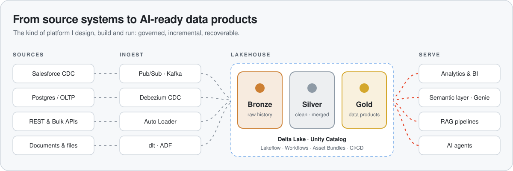

<!-- Header -->

  

  

  
  
  

## 👋 About me

I'm a **Senior Data Engineer** focused on building scalable data platforms, production-grade lakehouse architectures and data products that support analytics and AI use cases.

Currently working heavily with **Azure and Databricks**, designing and evolving end-to-end pipelines, medallion architectures and governed data products used by downstream analytics and AI applications.

<picture>
  <source media="(prefers-color-scheme: dark)" srcset="assets/lakehouse-flow-dark.svg" />
  <source media="(prefers-color-scheme: light)" srcset="assets/lakehouse-flow-light.svg" />
  
</picture>

## 🚀 What I work with

| Area | Stack |
|---|---|
| **Data Engineering** |     |
| **Lakehouse** |     Medallion Architecture (Bronze → Silver → Gold) |
| **Cloud** |   |
| **Orchestration** |   |
| **Data Integration** | REST API · Bulk API · CDC and event-driven ingestion |
| **Data & AI** |   RAG pipelines · document extraction · semantic layers |
| **DevOps** |     |
| **Data Modeling & Quality** | ETL/ELT · dimensional modeling · deduplication · incremental processing · data quality |
| **Learning in public** |           plus LLM / AI data pipelines:    |

## 🔭 Current interests

I'm currently exploring and building around:

- ⚡ Real-time and near-real-time data ingestion
- 🔁 CDC and Pub/Sub architectures
- 🌊 Streaming Lakehouse patterns
- 🤖 Data platforms for AI agents
- 📄 Document intelligence and RAG
- 🛡️ Databricks governance and platform engineering

## 🧪 Featured projects

| Project | What it does | Built with |
|---|---|---|
| 🏆 **[data-engineering-lab](https://github.com/lucasfazzib/data-engineering-lab)** | Hands-on lab for the modern open-source data stack, each topic a small self-contained Docker example with concepts, exercises and interview questions. Flagship: an **[Olist e-commerce data warehouse](https://github.com/lucasfazzib/data-engineering-lab/tree/main/13-olist-data-warehouse)** on real data, with a Kimball star schema, contracts, unit tests, ADRs, CI and a dashboard. | dbt · DuckDB · Postgres · dlt · Kafka · Debezium · Streamlit |
| ⚡ **[salesforce-realtime-lakehouse](https://github.com/lucasfazzib/salesforce-realtime-lakehouse)** | Salesforce Change Data Capture via the Pub/Sub API into a recoverable near-real-time lakehouse: replay checkpoints, Auto Loader into Bronze Delta history, then a CDC MERGE into Silver current state. | Python · gRPC/Avro · Auto Loader · Delta Lake · Lakeflow Jobs · Asset Bundles · GitHub Actions |
| 🔥 **[forge-api](https://github.com/lucasfazzib/forge-api)** + **[forge-infra](https://github.com/lucasfazzib/forge-infra)** | **Forge**, a self-hosted local AI lab: infrastructure-as-code for local LLMs on a GPU host, plus a containerized API with an agent loop, typed tool registry, policy gate and structured outputs. | FastAPI · Ollama · Open WebUI · Docker · CI |
| 📈 **[osrs-flipping-advisor](https://github.com/lucasfazzib/osrs-flipping-advisor)** | Medallion-style market-data pipeline for a game economy: cron-driven ingestion every 5 minutes, a quant engine for spreads and liquidity scores, a Postgres warehouse and a live dashboard. | Python · Polars · Supabase/Postgres · Streamlit · GitHub Actions |
| 🗺️ **[OSRS-Data-Lake-Player-Advisory-Platform](https://github.com/lucasfazzib/OSRS-Data-Lake-Player-Advisory-Platform)** | Bronze → Silver → Gold data platform on Databricks Free Edition that ingests wiki and hiscores APIs and serves a player advisory frontend. | Databricks · PySpark · Lakeflow · Asset Bundles · Streamlit |

<b>More repositories</b>

 

- **[end_to_end_azure_databricks](https://github.com/lucasfazzib/end_to_end_azure_databricks)**: end-to-end data engineering project with Azure, Databricks, Data Factory and Power BI.
- **[etl-python-postgres-ai-agents](https://github.com/lucasfazzib/etl-python-postgres-ai-agents)**: modular Python ETL into a Postgres warehouse, a Streamlit dashboard and an AI agent extension.
- **[dw_dbt](https://github.com/lucasfazzib/dw_dbt)**: data warehouse fed by API ingestion with Python, SQL and dbt.
- **[data_pipeline_api_films](https://github.com/lucasfazzib/data_pipeline_api_films)**: data cleaning and enrichment pipeline over a films API.

## 📊 GitHub activity

  <picture>
    <source media="(prefers-color-scheme: dark)" srcset="https://github-readme-stats.vercel.app/api?username=lucasfazzib&show_icons=true&hide_border=true&theme=github_dark" />
    
  </picture>
  <picture>
    <source media="(prefers-color-scheme: dark)" srcset="https://github-readme-stats.vercel.app/api/top-langs/?username=lucasfazzib&layout=compact&langs_count=6&hide_border=true&theme=github_dark" />
    
  </picture>

  <picture>
    <source media="(prefers-color-scheme: dark)" srcset="https://raw.githubusercontent.com/lucasfazzib/lucasfazzib/output/github-snake-dark.svg" />
    
  </picture>

## 🤝 Collaboration

I'm always interested in collaborating on:

<b>Data Engineering • Data Architecture • Lakehouse • Databricks • Data & AI Platforms</b>

## 📫 Connect with me

- LinkedIn: [linkedin.com/in/lucas-fazzi](https://www.linkedin.com/in/lucas-fazzi/)
- GitHub: [github.com/lucasfazzib](https://github.com/lucasfazzib)
- Email: **lucasfazzi@hotmail.com**

  

